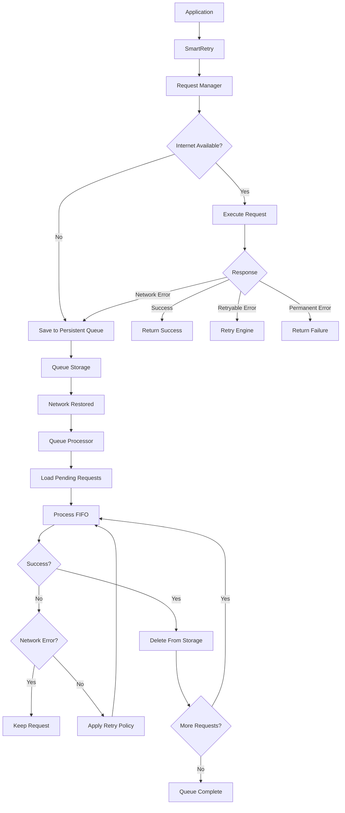

# react-native-smart-retry

A **persistent, mobile-aware offline request queue** for React Native. When a
request fails because the device has no connectivity, it's saved to disk —
not lost — and automatically replayed, in order, the moment the network
comes back. Survives app restarts, force-quits, and crashes mid-request.

This is not a generic "retry a promise" utility. It's built around one
specific, common mobile problem: a user taps a button, the device is
offline, and the request still needs to happen later without the user doing
anything else.

## Why this package?

Mobile networks are unreliable. A typical retry/HTTP library treats a
network failure as just another error to retry a few times and then give up
on — the request, and the user's action, is gone. `react-native-smart-retry`
instead treats **connectivity failures as expected and temporary**:

- A request explicitly opted into the queue (`queue: true`) is persisted to
  disk *before* being discarded, with everything needed to replay it later.
- It stays there — across app restarts — until it succeeds or permanently
  fails (e.g. a `400` validation error).
- The queue drains itself automatically, strictly in the order requests were
  created, the moment the device reconnects.

## Features

- 🔌 **Explicit, opt-in queueing** — `queue: true` per request. Nothing is queued automatically.
- 💾 **Persistent** — survives app restarts and crashes; pluggable storage (AsyncStorage included).
- 🔁 **FIFO sync** — requests replay in creation order; a stuck request blocks the ones behind it, not the ones already succeeded.
- 📶 **Reconnect-triggered** — no polling; listens for real connectivity changes.
- ♻️ **Configurable retry strategies** — fixed / linear / exponential / exponential-jitter, with `Retry-After` support.
- 🧠 **Correct error classification** — network failures are queued/retried; permanent errors (`400`, `401`, `403`, `404`, `422`) fail once, immediately.
- 🔒 **Duplicate protection** — `uniqueKey` prevents the same logical request from being queued twice.
- 🪪 **Idempotency-aware** — optional `idempotencyKey`, sent as an `Idempotency-Key` header.
- 📱 **App-lifecycle aware** — pauses while backgrounded, resumes in the foreground.
- 🩹 **Crash-safe recovery** — a request stuck mid-flight from a killed app is recovered, not lost or duplicated.
- 🧩 **Small, testable core** — the queue/retry engine has no React Native dependency; only the storage/network adapters do.

## Installation

```sh
npm install react-native-smart-retry @react-native-async-storage/async-storage
```

Also install `@react-native-community/netinfo` (recommended — without it,
offline detection falls back to "assume online" and only reacts to requests
actually failing):

```sh
npm install @react-native-community/netinfo
```

Then install pods on iOS:

```sh
cd ios && pod install
```

## Setup

Initialize once, near your app's root:

```tsx
import React, { useEffect } from 'react';
import { SmartRetry } from 'react-native-smart-retry';

export default function App() {
  useEffect(() => {
    SmartRetry.configure({
      debug: __DEV__,
      onSuccess: (request) => console.log('Synced', request.id),
      onFailure: (request, error) => console.log('Failed permanently', request.id, error.message),
    });

    SmartRetry.initialize();

    return () => {
      SmartRetry.destroy();
    };
  }, []);

  return <YourApp />;
}
```

`initialize()` is idempotent and safe to call from multiple places — it
loads the persisted queue, starts network monitoring, recovers any request
stuck mid-flight from a previous crash, and processes the queue immediately
if already online. You technically don't have to call it yourself: `request()`,
`queue()`, `processQueue()`, `getQueue()`, etc. all call it for you the first
time they're used. Calling it explicitly in a top-level `useEffect` just makes
the startup behavior (queue restoration, initial sync) deterministic and
early.

## Basic Usage

```ts
import { SmartRetry } from 'react-native-smart-retry';

const result = await SmartRetry.request({
  url: 'https://api.example.com/attendance',
  method: 'POST',
  data: { employeeId: 123, timestamp: Date.now() },
  queue: true,
});

switch (result.status) {
  case 'success':
    console.log('Sent immediately', result.response);
    break;
  case 'queued':
    console.log('Saved for later sync', result.queueId);
    break;
  case 'failed':
    console.log('Permanently failed', result.error.message);
    break;
}
```

A request **without** `queue: true` behaves like a normal HTTP call — it
just resolves to `{ status: 'failed', ... }` on error, nothing is persisted:

```ts
const result = await SmartRetry.request({ url: '/users/me', method: 'GET' });
```

## Offline Queue

Queueing is always explicit. Only a request with `queue: true` (or one sent
via `SmartRetry.queue()`) is ever written to disk:

```ts
await SmartRetry.request({
  url: '/attendance',
  method: 'POST',
  data,
  queue: true, // <-- opt-in
});
```

`SmartRetry.queue(options)` skips the live attempt entirely and persists
immediately — useful when you already know you want background-only
delivery (e.g. analytics-style events) rather than "try now, fall back to
later":

```ts
await SmartRetry.queue({ url: '/events', method: 'POST', data: event });
```

## Automatic Sync

Once online, `react-native-smart-retry` automatically drains the queue:
strictly FIFO, one request at a time, stopping the instant it hits another
network failure (so the rest of the queue waits for the *next* reconnect
rather than being attempted out of order). You can also trigger it manually:

```ts
await SmartRetry.processQueue();
```

## Retry Strategies

```ts
type RetryStrategy = 'fixed' | 'linear' | 'exponential' | 'exponential-jitter'; // default
```

| Strategy            | Delay for attempt *n* (base = 1000ms)          |
| ------------------- | ----------------------------------------------- |
| `fixed`              | `1000, 1000, 1000, …`                          |
| `linear`             | `1000, 2000, 3000, …`                          |
| `exponential`        | `1000, 2000, 4000, 8000, …`                    |
| `exponential-jitter` | `~1000, ~2000, ~4000, …` (±20% random jitter)   |

Configurable globally or per request:

```ts
await SmartRetry.request({
  url: '/orders',
  method: 'POST',
  data,
  queue: true,
  strategy: 'exponential-jitter',
  baseDelay: 1000,
  maxDelay: 30000,
  retries: 5,
});
```

Delay is always capped at `maxDelay`, regardless of strategy.

**`Retry-After`**: if a `429` response includes a `Retry-After` header
(numeric seconds, or an HTTP-date), that value is used instead of the
computed backoff — still capped at `maxDelay`, so a misbehaving server can't
stall the queue indefinitely.

**Immediate vs. queued retries**: `retries` / `strategy` / `baseDelay` /
`maxDelay` apply to two different things depending on context:
- For a request's **immediate attempt** (before it's ever queued), they
  drive in-process retry-with-backoff, resolved within the same `request()`
  call. A genuine connectivity failure (offline / timeout) is *not* retried
  in-process — see [Limitations](#limitations) — so a request fails or
  queues quickly rather than blocking on several backoff sleeps that are
  very unlikely to succeed while offline.
- For an **already-queued** request being replayed (possibly after an app
  restart), only JSON-serializable options survive persistence — `retries`
  and `retryOnStatusCodes` are stored per-request, but a custom `retryOn`
  function cannot be (functions aren't serializable), so replays fall back
  to the globally configured policy for that decision.

## Queue Management

```ts
await SmartRetry.getQueue();       // QueuedRequest[]
await SmartRetry.getQueueCount();  // number
await SmartRetry.remove(id);       // remove a single request
await SmartRetry.clearQueue();     // remove everything
await SmartRetry.processQueue();   // force a processing pass
await SmartRetry.isOnline();       // current connectivity
```

A request is **only ever removed after it succeeds**. On a network failure
it's reverted to `pending` and left in place; on a retryable server error
(e.g. `500`) it's rescheduled with backoff; only a genuinely permanent error
(or an exhausted retry budget) marks it `failed` — it's still visible via
`getQueue()`/`getQueueCount()` for inspection, it just won't be retried
automatically anymore.

## Duplicate Protection

Pass `uniqueKey` to prevent the same logical action from being queued twice
(e.g. a double-tap while offline):

```ts
await SmartRetry.request({
  url: '/attendance',
  method: 'POST',
  data: { employeeId: 123 },
  queue: true,
  uniqueKey: 'attendance-123-2026-09-17',
});
```

If a pending (or currently processing) request already has that `uniqueKey`,
the new call returns the *existing* queued request instead of creating a
duplicate. Disable this globally with `SmartRetry.configure({ preventDuplicates: false })`.

## Idempotency

```ts
await SmartRetry.request({
  url: '/payments',
  method: 'POST',
  data,
  queue: true,
  idempotencyKey: 'payment-8f14e...',
});
```

When set, `idempotencyKey` is sent as an `Idempotency-Key` header on every
attempt (including replays after a restart). **This does not itself
guarantee idempotency** — that only holds if your server actually
deduplicates by that header. Use it together with `uniqueKey` for
client-side + server-side protection.

## Authentication

`react-native-smart-retry` does **not** implement automatic token refresh.
If a queued request comes back with `401`, it's classified as a permanent
`CLIENT_ERROR` and marked `failed` (surfaced via `onFailure`) rather than
retried forever against a now-expired token. Handle re-authentication in
your own app logic — e.g. listen for `onFailure`, check `error.status === 401`,
refresh your session, and re-`request()` if appropriate. The architecture
leaves room for a token-refresh hook in a future version (see
[Roadmap](#roadmap)).

## Error Handling

Every failure is classified into one `RetryReason`:

| Reason          | Meaning                                   | Default behavior                         |
| ---------------- | ------------------------------------------ | ------------------------------------------ |
| `NETWORK_ERROR`  | No connectivity / DNS / connection failure | Queued (if `queue:true`) / retried        |
| `TIMEOUT`        | Request exceeded its timeout               | Queued (if `queue:true`) / retried        |
| `SERVER_ERROR`   | `500`, `502`, `503`, `504`, or `408`        | Retried, then queued if still failing     |
| `RATE_LIMIT`     | `429` (honors `Retry-After`)               | Retried with backoff                      |
| `CLIENT_ERROR`   | `400`, `401`, `403`, `404`, `422`           | **Fails immediately, never queued/retried** |
| `UNKNOWN`        | Anything else                              | Retried only if `retryOn` says so         |

Customize the classification:

```ts
await SmartRetry.request({
  url: '/orders',
  method: 'POST',
  data,
  retryOnStatusCodes: [408, 429, 500, 502, 503, 504],
  retryOn: (error) => true, // full override
});
```

**Unsafe HTTP methods** (`POST`, `PUT`, `PATCH`, `DELETE`) are never
auto-retried on the *immediate* attempt unless you explicitly allow it —
a `500` from a `POST` might have partially succeeded server-side:

```ts
await SmartRetry.request({ url: '/orders', method: 'POST', data, retryMethods: ['POST'] });
```

This restriction does not apply once a request has already been queued
(`queue: true` is itself the explicit opt-in for that specific request).

## Storage

Queue persistence is behind a small interface:

```ts
export interface QueueStorage {
  add(request: QueuedRequest): Promise<void>;
  getAll(): Promise<QueuedRequest[]>;
  get(id: string): Promise<QueuedRequest | null>;
  update(id: string, data: Partial<QueuedRequest>): Promise<void>;
  remove(id: string): Promise<void>;
  clear(): Promise<void>;
}
```

The included `AsyncStorageStorage` stores each request under its own key
(plus a small id index), rather than one large JSON blob, so a write to one
request can't corrupt the others — and a corrupted individual record is
skipped (logged), never silently wipes the whole queue.

Bring your own storage (MMKV, SQLite, …) by implementing `QueueStorage` and
passing it to a custom instance:

```ts
import { createSmartRetry } from 'react-native-smart-retry';

const client = createSmartRetry({ storage: myCustomStorage });
```

## Events

```ts
SmartRetry.configure({
  onQueued: (request) => {},
  onRetry: (info) => {}, // { requestId, attempt, maxRetries, reason, delay }
  onSuccess: (request, response) => {},
  onFailure: (request, error) => {},
  onQueueStart: () => {},
  onQueueComplete: (summary) => {}, // { processed, succeeded, failed }
  onNetworkChange: (state) => {}, // { isConnected, isInternetReachable }
});
```

## Debugging

```ts
SmartRetry.configure({ debug: true });
```

```text
[SmartRetry] Initialized
[SmartRetry] Network: offline
[SmartRetry] Queueing request req_1a2b3c
[SmartRetry] Network: online
[SmartRetry] Queue processing started
[SmartRetry] Processing req_1a2b3c
[SmartRetry] Request successful
[SmartRetry] Removed req_1a2b3c
[SmartRetry] Queue processing completed
```

Debug logs only ever include request ids, URLs, methods, and error
metadata — **never** headers, request bodies, tokens, or cookies, even with
`debug: true`. If your payloads may contain sensitive fields, use
`transformBeforePersist` to redact them before they're written to disk:

```ts
SmartRetry.configure({
  transformBeforePersist: (request) => ({
    ...request,
    data: request.data && typeof request.data === 'object'
      ? { ...request.data, password: undefined }
      : request.data,
  }),
});
```

## API Reference

```ts
SmartRetry.initialize(): Promise<void>
SmartRetry.destroy(): void
SmartRetry.configure(config: SmartRetryConfig): void

SmartRetry.request<T>(options: SmartRetryRequestOptions): Promise<SmartRetryResult<T>>
SmartRetry.queue(options: SmartRetryRequestOptions): Promise<SmartRetryResult>
SmartRetry.processQueue(): Promise<void>

SmartRetry.getQueue(): Promise<QueuedRequest[]>
SmartRetry.getQueueCount(): Promise<number>
SmartRetry.remove(id: string): Promise<void>
SmartRetry.clearQueue(): Promise<void>
SmartRetry.isOnline(): Promise<boolean>
```

See [`src/types/index.ts`](src/types/index.ts) for the full `SmartRetryRequestOptions`,
`SmartRetryConfig`, `SmartRetryResult`, and `QueuedRequest` shapes — every
public field is documented there.

## Example

See [`example/`](example/README.md) for a runnable demo screen (network
status, queue count, create/process/clear queue) backed by a built-in mock
API, so it works with no real backend.

## Architecture



The core (`queue/`, `retry/`, `errors/`, `storage/` interface) has no React
Native dependency and is unit-testable in plain Node — only
`storage/AsyncStorageStorage.ts`, `network/NetworkManager.ts`'s default
monitor, and `lifecycle/AppLifecycleManager.ts` touch RN/its ecosystem, and
each is a small, swappable adapter behind an interface.

## Limitations

- No automatic token refresh (see [Authentication](#authentication)).
- A custom `retryOn` predicate only applies to a request's immediate,
  pre-queue attempt — it cannot be persisted, so a queued replay after an
  app restart falls back to the globally configured retry policy.
- Genuine connectivity failures (`NETWORK_ERROR` / `TIMEOUT`) are not
  retried in-process on the immediate attempt — they fail or queue right
  away rather than blocking the caller on backoff sleeps that are unlikely
  to succeed while actually offline. (Queued requests still get their full
  retry treatment once connectivity returns.)
- Without `@react-native-community/netinfo` installed, connectivity is
  assumed "online" until a request actually fails — automatic
  offline-detection and reconnect-triggered sync require it.
- No request prioritization — v1 is strict FIFO by design; priority queues
  are a possible future addition (see Roadmap).
- No built-in request deduplication across devices/servers — `uniqueKey`
  and `idempotencyKey` are client-side and header-level aids, not a
  distributed-systems guarantee.

## Security Considerations

- Queued request data (URL, headers, body) is **persisted to local device
  storage** in plain form by default. Only queue requests whose payloads are
  acceptable to have on-disk, and use `transformBeforePersist` to redact
  sensitive fields (passwords, full card numbers, etc.) before they're
  written.
- Debug logs never include headers, bodies, cookies, or tokens — only
  request ids, URLs, methods, and error metadata.
- `idempotencyKey` is a hint to your server, not a security boundary — it
  does not, by itself, prevent replay or duplicate processing unless your
  backend enforces it.

## Roadmap

- Pluggable MMKV / SQLite storage adapters.
- Optional request prioritization within the queue.
- Pluggable token-refresh hook for `401` responses.
- Batch/parallel processing mode as an opt-in alternative to strict FIFO.

## License

MIT © react-native-smart-retry contributors — see [LICENSE](LICENSE).
