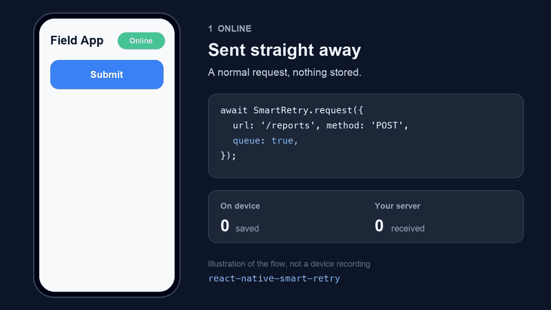
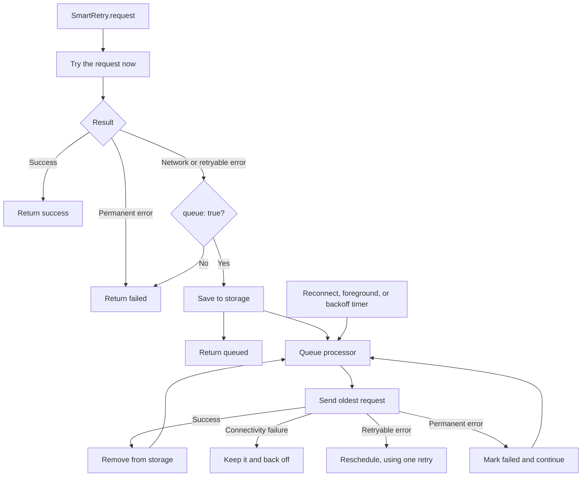

# react-native-smart-retry

[](https://www.npmjs.com/package/react-native-smart-retry)
[](https://www.npmjs.com/package/react-native-smart-retry)
[](https://github.com/adityarajput751/react-native-smart-retry/actions/workflows/ci.yml)
[](src/types/index.ts)
[](LICENSE)

**Never lose a user's action to a bad connection.**

Your user taps "Submit" in a lift, on a train, or in a basement. With plain `fetch`, that action is gone.
With `react-native-smart-retry` it's saved to disk and sent automatically, in order, when the network
returns, even if the app was closed in between.

<p align="center">
  
</p>

```ts
const result = await SmartRetry.request({
  url: 'https://api.example.com/attendance',
  method: 'POST',
  data: { employeeId: 123 },
  queue: true, // <-- that's it
});

// 'success' → sent now
// 'queued'  → saved, will be sent automatically
// 'failed'  → permanent error, e.g. a 400
```

## Why use it

|                                     | `fetch` | Retry wrapper | **smart-retry** |
| ----------------------------------- | :-----: | :-----------: | :-------------: |
| Retries with backoff                |    ❌    |       ✅       |        ✅        |
| Survives app restarts and crashes   |    ❌    |       ❌       |        ✅        |
| Sends automatically on reconnect    |    ❌    |       ❌       |        ✅        |
| Keeps requests in order             |    ❌    |       ❌       |        ✅        |
| Fresh auth token on delayed sends   |    ❌    |       ❌       |        ✅        |
| Duplicate and double-tap protection |    ❌    |       ❌       |        ✅        |
| React hook for sync status          |    ❌    |       ❌       |        ✅        |

- **Pure JavaScript.** No native code of its own, only AsyncStorage and NetInfo.
- **Opt-in per request.** Nothing is stored unless you pass `queue: true`.
- **TypeScript first.** Every option and result is typed.
- **Pluggable.** Bring your own storage, such as MMKV or SQLite.

## Install

```sh
npm install react-native-smart-retry @react-native-async-storage/async-storage @react-native-community/netinfo
cd ios && pod install
```

With Expo:

```sh
npx expo install @react-native-async-storage/async-storage @react-native-community/netinfo
npm install react-native-smart-retry
```

NetInfo is optional but recommended. Without it, the app can't detect reconnects, so the queue only
syncs when the app returns to the foreground, a new request is queued, or you call `processQueue()`.

## Quick start

Configure once, outside your components:

```ts
// App.tsx
import { SmartRetry } from 'react-native-smart-retry';

SmartRetry.configure({
  baseURL: 'https://api.example.com',
  beforeRequest: async (request) => ({
    ...request,
    headers: { ...request.headers, Authorization: `Bearer ${await getToken()}` },
  }),
  onFailure: (request, error) => console.warn('Could not deliver', request.url, error.message),
});

SmartRetry.initialize(); // restores the queue and starts syncing
```

Then send requests from anywhere:

```ts
const result = await SmartRetry.request({
  url: '/orders',
  method: 'POST',
  data: order,
  queue: true,
  uniqueKey: `order-${order.id}`,
  idempotencyKey: order.id,
});

if (result.status === 'failed') {
  showError(result.error.data ?? result.error.message); // includes the server's error body
}
```

`request()` and `queue()` resolve with a result for request and queue failures, so you don't need `try/catch`.

Show sync status in your UI:

```tsx
import { useSmartRetryQueue } from 'react-native-smart-retry';

function SyncBadge() {
  const { pendingCount, failedCount, isOnline, isSyncing } = useSmartRetryQueue();

  if (!isOnline) return <Text>Offline: {pendingCount} waiting</Text>;
  if (isSyncing) return <Text>Syncing {pendingCount}…</Text>;
  if (failedCount > 0) return <Button title="Retry" onPress={() => SmartRetry.retryFailed()} />;
  return null;
}
```

## How it behaves

| What happened                                   | Reason          | With `queue: true`                 | Without              |
| ----------------------------------------------- | --------------- | ---------------------------------- | -------------------- |
| No connection                                   | `NETWORK_ERROR` | Queued                             | `failed`             |
| Timed out                                       | `TIMEOUT`       | Queued                             | `failed`             |
| `408`, `500`, `502`, `503`, `504`               | `SERVER_ERROR`  | Queued, with backoff               | `failed`             |
| `429`                                           | `RATE_LIMIT`    | Queued, honoring `Retry-After`     | `failed`             |
| Other `4xx`, such as `400`, `403`, `404`, `422` | `CLIENT_ERROR`  | `failed`, never retried            | `failed`             |
| Other `5xx`, such as `501`                      | `SERVER_ERROR`  | `failed`, never retried            | `failed`             |
| Cancelled through `signal`                      | `ABORTED`       | `failed`, never queued             | `failed`             |

Safe methods (`GET`, `HEAD`, `OPTIONS`) are also retried in place on retryable server errors before
any of the above. Unsafe methods are not, unless you list them in `retryMethods`, because a `POST` that
returned `500` may have partly succeeded. Connectivity failures skip in-place retries so the caller
isn't left waiting.

### How the queue syncs

- Requests are sent strictly oldest first, one at a time.
- A sync starts on reconnect, on return to the foreground, when a request is queued, and on `processQueue()`.
- If the device says it's online but the server can't be reached, the queue retries with backoff.
  These failures never use up a request's `retries`.
- A retryable server error holds the queue until its backoff ends, so order is preserved.
- A permanent failure marks that request `failed` and the queue moves on. It stays in storage until
  you call `retryFailed()` or `remove()`.

### Delivery guarantee

Delivery is **at-least-once**. If the app is killed after the server handled a request but before it
was removed from the queue, it's sent again on the next launch. Lost responses can have the same effect.

For anything that must not happen twice, such as payments, send an `idempotencyKey` and have your
server deduplicate on the `Idempotency-Key` header.

Ordering applies inside the queue. A live `request()` can reach the server ahead of older queued
requests, so if order matters across a set of actions, send them all with `SmartRetry.queue()`.

## Authentication

Saved requests can outlive a token, so don't store tokens with them. `beforeRequest` runs before
every attempt, including replays days later:

```ts
SmartRetry.configure({
  beforeRequest: async (request) => ({
    ...request,
    headers: { ...request.headers, Authorization: `Bearer ${await getToken()}` },
  }),
  onUnauthorized: async () => {
    await refreshSession();
    return true; // retry the request once with the new token
  },
});
```

Concurrent `401`s share a single `onUnauthorized` call. Return `false` to let the request fail.

When a user logs out, call `SmartRetry.clearQueue()`. It removes everything and cancels any request in flight.

## Retry strategies

```ts
await SmartRetry.request({
  url: '/orders',
  method: 'POST',
  data,
  queue: true,
  strategy: 'exponential-jitter',
  baseDelay: 1000,
  maxDelay: 30000,
  retries: 5,
});
```

| Strategy                       | Delay with `baseDelay: 1000`    |
| ------------------------------ | ------------------------------- |
| `fixed`                        | `1000, 1000, 1000, …`           |
| `linear`                       | `1000, 2000, 3000, …`           |
| `exponential`                  | `1000, 2000, 4000, 8000, …`     |
| `exponential-jitter` (default) | The same, with ±20% random jitter |

All of these can be set globally in `configure()` or per request, and per-request values are kept for
replays. Delays are capped at `maxDelay`, including `Retry-After`, so a server can't stall the queue indefinitely.

`retryOnStatusCodes` changes which statuses are retryable. `retryOn: (error) => boolean` replaces that
decision for the immediate attempt only, because functions can't be stored. It doesn't override the
`retryMethods` check.

## Duplicates

`uniqueKey` stops the same action being sent twice, including a double-tap:

```ts
await SmartRetry.request({ url: '/attendance', method: 'POST', data, queue: true, uniqueKey: 'attendance-123-2026-11-06' });
```

If the same key is already running or queued, you get that request's result instead of a new one.
Failed requests don't count. Turn this off with `configure({ preventDuplicates: false })`.

## Limiting the queue

Android's AsyncStorage has a default limit of about 6 MB, so bound the queue if requests can pile up:

```ts
SmartRetry.configure({
  maxQueueSize: 500, // when full, evicts the oldest failed request, else returns QUEUE_FULL
  maxRequestAge: 7 * 24 * 60 * 60 * 1000, // older requests fail with EXPIRED instead of being sent
});
```

## Custom storage

Implement `QueueStorage` and pass it to your own client. AsyncStorage isn't needed in that case.

```ts
import { createSmartRetry, type QueueStorage } from 'react-native-smart-retry';

const storage: QueueStorage = {
  add, getAll, get, update, remove, clear,
};

export const client = createSmartRetry({ storage });
```

## Uploads

`FormData`, `Blob`, and `ArrayBuffer` bodies work on immediate requests. They can't be stored, so with
`queue: true` a failed upload resolves as `failed` rather than being saved broken. To queue an
upload, store its file path in JSON and build the body in `beforeRequest`.

## API

```ts
SmartRetry.configure(config): void
SmartRetry.initialize(): Promise<void>       // optional: runs on first use
SmartRetry.destroy(): void

SmartRetry.request<T>(options): Promise<SmartRetryResult<T>>
SmartRetry.queue(options): Promise<SmartRetryResult>        // store without a live attempt

SmartRetry.processQueue(): Promise<void>     // sync now, ignoring backoff
SmartRetry.retryFailed(id?): Promise<number> // requeue failed requests
SmartRetry.getQueue(): Promise<QueuedRequest[]>
SmartRetry.getQueueCount(status?): Promise<number>
SmartRetry.remove(id): Promise<void>
SmartRetry.clearQueue(): Promise<void>

SmartRetry.isOnline(): Promise<boolean>
SmartRetry.isProcessing(): boolean
SmartRetry.on(event, listener): () => void

useSmartRetryQueue(client?): SmartRetryQueueState
createSmartRetry(options?): SmartRetryClient
```

### Config

| Option                             | Default              | Description                                          |
| ---------------------------------- | -------------------- | ---------------------------------------------------- |
| `baseURL`                          | none                 | Prepended to relative URLs                           |
| `beforeRequest`                    | none                 | Change a request before every attempt                |
| `onUnauthorized`                   | none                 | Refresh a session on `401`; return `true` to retry   |
| `transformBeforePersist`           | none                 | Change or redact a request before it's stored        |
| `timeout`                          | `15000`              | Per-attempt timeout in ms                            |
| `retries`                          | `3`                  | Retries before a request fails                       |
| `strategy`                         | `exponential-jitter` | Backoff strategy                                     |
| `baseDelay` / `maxDelay`           | `1000` / `30000`     | Backoff range in ms                                  |
| `retryOnStatusCodes`               | `408, 429, 5xx*`     | \*`500`, `502`, `503`, `504`                         |
| `retryMethods`                     | none                 | Unsafe methods allowed to retry in place             |
| `maxQueueSize`                     | unlimited            | Maximum stored requests                              |
| `maxRequestAge`                    | unlimited            | Maximum queued age in ms                             |
| `preventDuplicates`                | `true`               | Enable `uniqueKey`                                   |
| `pauseWhenBackgrounded`            | `true`               | Pause syncing while backgrounded                     |
| `debug`                            | `false`              | Log activity, without headers or bodies              |

Every field is documented in [`src/types/index.ts`](src/types/index.ts).

### Events

Pass callbacks to `configure()`, or use `SmartRetry.on()` for several listeners:

| `configure()`     | `on()`          | Payload                                 |
| ----------------- | --------------- | --------------------------------------- |
| `onQueued`        | `queued`        | Request                                 |
| `onRetry`         | `retry`         | `{ requestId, attempt, maxRetries, reason, delay }` |
| `onSuccess`       | `success`       | Request and response                    |
| `onFailure`       | `failure`       | Request and error                       |
| `onQueueStart`    | `queueStart`    | None                                    |
| `onQueueComplete` | `queueComplete` | `{ processed, succeeded, failed }`      |
| `onNetworkChange` | `networkChange` | `{ isConnected, isInternetReachable }`  |
| None              | `queueChanged`  | None                                    |

`onSuccess` and `success` fire for queued deliveries. For live requests, use the result of `request()`.

## Security

- Queued requests are stored **unencrypted**. Use `beforeRequest` for tokens so they're never written
  down, and `transformBeforePersist` to strip sensitive fields you don't need on replay:

  ```ts
  SmartRetry.configure({
    transformBeforePersist: (request) => ({ ...request, headers: undefined }),
  });
  ```

  Removed data isn't sent on replay unless `beforeRequest` adds it back. For encryption, use custom storage.
- Failed response bodies are returned to your code but never stored.
- Debug logs contain request ids, URLs, methods, and error details, but never headers or bodies. Avoid
  putting secrets in URLs.

To report a vulnerability, see [SECURITY.md](SECURITY.md).

## Troubleshooting

**The queue isn't syncing.** Run with `configure({ debug: true })`. Check that NetInfo is installed,
and whether the head request is waiting for a backoff delay. `processQueue()` skips that delay.

**Nothing syncs in the background.** That's the default, because mobile platforms suspend JavaScript
anyway. Syncing resumes in the foreground. This package doesn't schedule background tasks.

**Testing your app.** Use `createSmartRetry()` with your own `storage`, `networkMonitor`, and
`appState: null` to run without native modules.

## How it's built



The queue, retry, and error logic has no React Native dependency. Storage, network, and app state are
small adapters behind interfaces.

## Example

[`example/`](example/README.md) has a demo screen with a mock API, so it needs no backend.

## Contributing

Issues and pull requests are welcome. See [CONTRIBUTING.md](CONTRIBUTING.md) and the [changelog](CHANGELOG.md).

## License

MIT. See [LICENSE](LICENSE).

## ☕ Buy Me a Coffee

If this package saves you time, consider supporting its development.

<a href="https://www.buymeacoffee.com/adityarajput" target="_blank">
    
</a>
